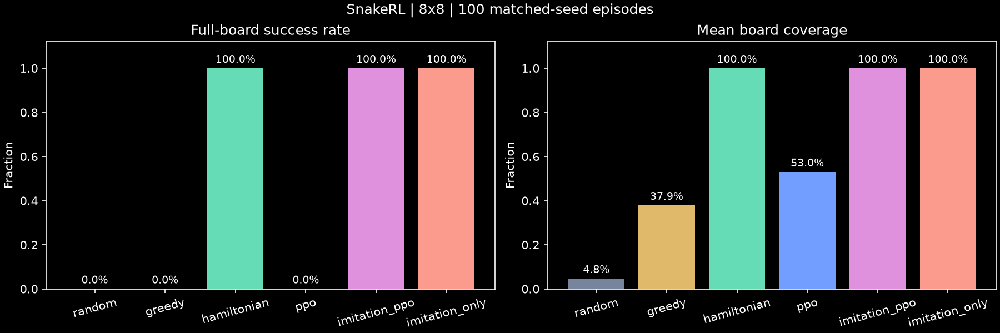
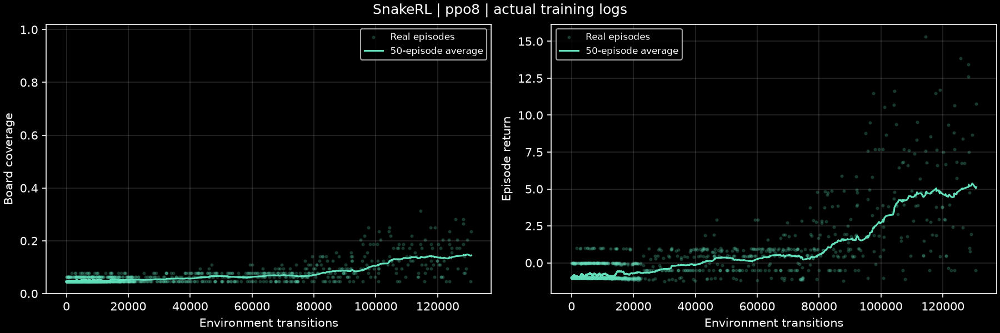
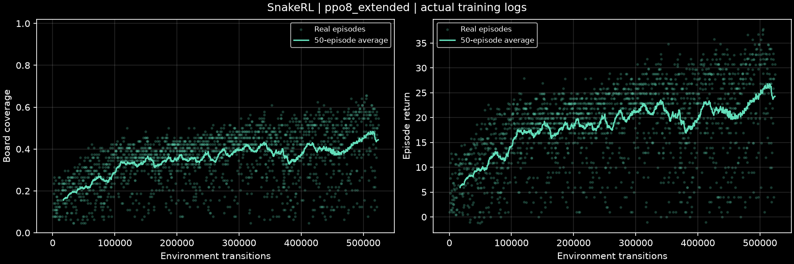

# 首次真实实验 · 2026-10-12

8×8 闭环已运行：训练、保存模型、纯神经网络评估、同种子比赛、训练曲线与成功/失败回放。

**专家模仿 + PPO 的网络在 1,000 局随机食物测试中取得 1,000/1,000 全覆盖；从零 PPO 的最佳模型在 100 局测试中平均覆盖 53.0%，仍未通关。** 当前初始蛇身固定在顶行，长度 3、朝东；这些结果不代表任意初始状态、障碍物或 20×20 上的表现。

## 同种子比赛

全部策略使用种子 10000–10099。神经网络采用动作概率 argmax，没有动作屏蔽、寻路或专家调用。

| 策略 | 全覆盖成功 | 平均覆盖率 | 最高覆盖率 | 成功局平均步数 |
|---|---:|---:|---:|---:|
| Random | 0/100 | 4.8% | 7.8% | — |
| 贪心 BFS | 0/100 | 37.9% | 67.2% | — |
| 哈密顿回路 | 100/100 | 100% | 100% | 981.48 |
| 从零 PPO（内部验证选出的最佳模型） | 0/100 | 53.0% | 71.9% | — |
| 模仿 + PPO（最终模型） | 100/100 | 100% | 100% | 981.48 |
| 仅模仿（微调前模型） | 100/100 | 100% | 100% | 981.48 |



纯 PPO 的 100 局中，99 局撞身体、1 局未进食超时。它学会了明显优于随机策略的吃食物行为，但拥挤棋盘上的规划仍有缺陷。示范学习网络在这组测试中的步数与哈密顿基线一致；本轮未观察到 PPO 微调带来通关率或步数收益，不能据此声称网络学会了安全捷径。

完整汇总见 [comparison100.json](data/comparison100.json)，纯 PPO 逐局记录见 [ppo100.csv](data/ppo100.csv)。

## 1,000 局独立测试

模仿 + PPO 的最终模型使用种子 10000–10999，全部成功，平均通关 **977.824 步**。成功率的 95% Wilson 区间为 **[99.617%, 100%]**；有限测试不能证明所有种子永远成功。这 1,000 局包括上表的前 100 局，不是额外互不重叠的 1,000 局。

测试种子与训练、专家数据和内部模型选择的种子分离。所有神经评估仅执行保存的 actor。完整逐局记录见 [imitation1000.json](data/imitation1000.json)。

## 实验设置与模型来源

CPU、Python 3.13.11、PyTorch 2.14.1+cpu、Gymnasium 1.4.0、Stable-Baselines3 2.9.0。精确依赖见仓库 `uv.lock` 与 [runtime.json](data/runtime.json)。模型架构是 3 层小卷积，融合全局池化、蛇头特征和坐标，再接 actor / critic。

纯 PPO 从随机权重开始，先训练 131,072 环境步，再迁移自身权重继续 524,288 步，累计收集 655,360 步。两阶段之间优化器重建，熵系数从 0.01 调到 0.02；全程未使用专家。比赛前按内部验证集（种子 1000000–1000004）选择 `runs/ppo8_extended/checkpoints/best.zip`，未使用比赛种子选择模型。最后一次 PPO 更新后，最终模型的内部覆盖率下降；这说明短训练存在不稳定性，因此保留了最佳和最终模型的区别。

模仿学习收集 30,652 个哈密顿专家状态/动作对，按整局种子划分：训练集 24,673 个、验证集 5,979 个。CNN actor 训练 30 个 epoch，学习率 0.001，验证动作准确率达到 100%。随后使用学习率 0.00001、熵系数 0，进行 8,192 步 PPO 微调。比赛评估的是 `runs/imitation8/final.zip`；单独评估 `checkpoints/bc.zip` 用于区分微调前后的效果。该路线证明了网络可以独立执行所学策略；它依赖专家示范，不是纯 PPO 自发发现回路的证据。

配置、数据划分和模型 SHA-256 见 [data/](data/)。本次 8×8 数据采集保留完整专家轨迹；代码随后为大棋盘加入了有界采样，8×8 默认样本行为保持一致。





## 在当前工作区复查

```powershell
uv run snakerl compare --size 8 --episodes 100 --seed-start 10000 --model ppo=runs/ppo8_extended/checkpoints/best.zip --model imitation_ppo=runs/imitation8/final.zip --model imitation_only=runs/imitation8/checkpoints/bc.zip --out runs/recheck100
uv run snakerl evaluate --policy neural --checkpoint runs/imitation8/final.zip --size 8 --episodes 1000 --seed-start 10000 --batch-size 64 --out runs/recheck1000
uv run snakerl play --policy neural --checkpoint runs/imitation8/final.zip --size 8 --fps 60 --run-dir runs/imitation8
uv run snakerl play --replay runs/race8/ppo/replay_failure.json
```

模型和完整回放保留在本地 `runs/`，不加入 Git。Git 中保留小体积的真实数据、配置与图表；新克隆按 README 的命令重新训练。
