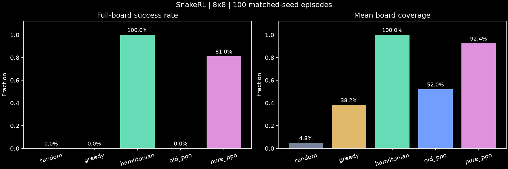
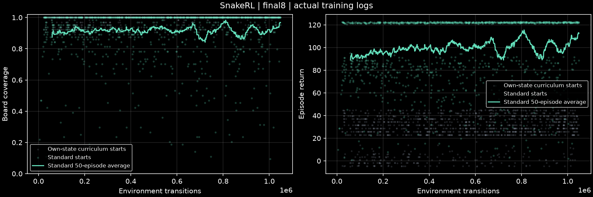

# 纯 PPO 迭代：全覆盖与可变路线 · 2026-10-14

**8×8 纯 PPO 在独立 1,000 局测试中取得 811/1,000 全覆盖。** 网络仅根据棋盘观察输出三个动作，没有专家示范、动作屏蔽、寻路或哈密顿回路调用。前 100 局中，81 个成功轨迹全部出现同一位置选择不同后继位置的行为，可排除“始终照走一条固定位置回路”。

它已经能够通过纯 PPO 完成棋盘全覆盖，并学到了可变路线；**尚未实现稳定 100% 通关，也没有全局最短路径的证明**。哈密顿基线仍然更可靠。

## 最终独立测试

全部从固定的长度 3 蛇身、顶行朝东开始，食物随机生成在空格中。训练课程的长蛇开局没有进入标准测试。神经动作采用确定性 argmax，不靠多次重试或随机抽样择优。

| 棋盘 | 纯 PPO 全覆盖 | 平均覆盖率 | 成功局平均步数 | 对照同一批成功种子的哈密顿步数 |
|---|---:|---:|---:|---:|
| 4×4 | 1,000/1,000 | 100% | 49.483 | 52.280 |
| 6×6 | 69/100 | 81.9% | 308.014 | 299.304 |
| 8×8 | 811/1,000 | 91.7% | 837.462 | 973.559 |

4×4 和 6×6 使用种子 70000 起；8×8 最终确认集使用此前未用于该模型训练和选择的 90000–90999。8×8 成功率的 95% Wilson 区间为 **78.56%–83.41%**。每个配置只做了单个训练种子的探索，区间不包含重新训练的种子间波动。

8×8 未成功的 189 局：99 局撞身体、89 局未进食超时、1 局撞墙。失败案例真实保留，没有将其从成功率分母中排除。

在 811 个成功种子上，PPO 相比对应哈密顿局平均少走 **136.096 步，约 14.0%**，配对 bootstrap 95% 区间为少走 **126.92–144.83 步**。这是成功子集中的效率结果，不能说新模型在总体上优于 100% 通关的哈密顿基线。4×4 两者都 1,000/1,000 通关，PPO 平均少走 5.35%；6×6 尚未显示速度收益。

相同环境种子固定随机数源；蛇身位置不同后，可用格子不同，后续食物坐标可能不同。因此这些是同一随机游戏机制上的比较，不是某一条固定食物序列上的最优性证明。几何距离下界忽略身体约束与未来食物的不确定性，也不能作为已达到最短路径的证据。

完整逐局数据、区间与配对统计见 [summary.json](ppo_iteration/data/summary.json)、[8×8 逐局结果](ppo_iteration/data/pure_ppo_8_evaluation.json) 和 [哈密顿逐局结果](ppo_iteration/data/hamiltonian_8_evaluation.json)。

## 新旧模型同种子比赛

下图与表格取最终确认集的前 100 局（90000–90099），是上述 1,000 局的子集，并非额外互不重叠的测试。

| 策略 | 全覆盖 | 平均覆盖率 | 成功局平均步数 |
|---|---:|---:|---:|
| Random | 0/100 | 4.8% | — |
| 贪心 BFS | 0/100 | 38.2% | — |
| 哈密顿回路 | 100/100 | 100% | 977.8 |
| 原纯 PPO 最佳模型 | 0/100 | 52.0% | — |
| 新纯 PPO 最佳模型 | 81/100 | 92.4% | 846.2 |



## 怎样判断路线不同于固定回路

仅与某条哈密顿基线的动作不同，不足以证明新策略不是另一条固定回路。这里记录一整局每个位置的实际后继位置：若同一位置出现两个或更多不同出口，它就无法由一个固定的位置后继映射解释。

- 4×4：分析 100 个成功局，78 局出现这种变化。
- 6×6：分析前 20 局中的 13 个成功局，13 局均出现变化。
- 8×8：分析前 100 局中的 81 个成功局，81 局均出现变化。

例如 8×8 种子 90000，模型在 898 步填满棋盘，有 **43 个位置**在该局中出现不同出口。这证明该局没有始终沿单一固定位置回路前进；不证明策略与一切循环结构的思想无关。全覆盖时蛇身本身也必然形成一条覆盖所有格子的路径。

轨迹分析只在游戏结束后运行，不能向策略提供动作。完整分析见 [trajectory8.json](ppo_iteration/data/trajectory8.json)，代表性完整回放见 [adaptive8_replay.json](ppo_iteration/adaptive8_replay.json)。

归档时，用冻结的模型重新计算了代表回放每一步的动作概率与 argmax，并逐步重演环境，确认最后达到 64/64；回放并非用传统算法生成后贴上神经网络标签。

## 实际做过的迭代

本轮总计采集 **12,582,912 个新的环境步**，分布在十个实验阶段；这不是最终模型单独训练了这么多步。训练栈仍为 Gymnasium、PyTorch CNN、Stable-Baselines3 PPO，CPU 训练，依赖由 uv 锁定。

1. **稳定性与长视野**：延长 rollout，增加并行环境，提高折扣因子，线性衰减学习率与熵系数，并使用 KL 阈值限制过大的更新。8×8 的验证覆盖率提高，但这一阶段仍未通关。
2. **小棋盘课程**：从随机权重训练 4×4，再迁移到 6×6；只继承 PPO 权重。4×4 达到稳定全覆盖，6×6 部分成功。较大棋盘的权重迁移不自动保证通关。
3. **观察与奖励实验**：计时通道补上时间信息；二值占用和尾巴通道帮助网络读取原本包含在身体顺序里的信息。测试过提高后期食物/死亡权重的奖励，但该奖励单独没有解决 8×8。
4. **独立 actor/critic 编码器**：避免 critic 的反向传播直接更新 actor 的 CNN。测试验证了这种梯度隔离；性能还同时受训练时长和种子影响，不能单独归因于这一改动。
5. **自身经验的收尾课程**：保存当前 PPO 在真实游戏中到达的高覆盖状态，部分训练局从这些状态开始，并重新生成食物。没有构造专家路径或专家动作。最终有效组合使用 85% 覆盖门槛、50% 课程概率、13 通道观察、独立编码器和较柔和的初始动作分布。
6. **降低学习率微调**：从首次通关模型继续 PPO，用内部验证集按“成功率优先、成功局步数其次”选最佳模型，再冻结模型进行独立确认。

初始动作温度只在新训练阶段初始化时缩放网络 logits；采集和更新都使用该策略，最终测试没有额外温度、动作筛选或兜底。历史残局只是 PPO 自身产生的初始状态分布，后续动作和梯度更新仍由 PPO 完成。

负结果同样保留：较大的后期奖励、较低门槛的自身课程，以及单独增强探索，都没有独立实现稳定 8×8 通关。这组实验不是多种子、逐变量控制的因果消融，不能据此断言某一个参数是唯一原因。

原 9 通道模型仍可加载。观察版本 2 为 11 通道（加未进食和总步数计时）；版本 3 为 13 通道（再加二值蛇身占用与尾巴位置）。迁移增加的输入权重初始化为零，并验证迁移前后动作分布一致。

`coverage` 奖励：每步 −0.003，食物 `+1+2×覆盖率²`，全覆盖额外 +20，碰撞 `−1−4×覆盖率²`，超时额外 −1，距离塑形设为 0。它没有图搜索或可达性奖励。标准比赛使用统一的 legacy 奖励记录；成功率和步数由实际游戏结果决定。

训练曲线的主均值只使用正常开局，课程开局以灰色散点另画。课程局自身的高初始覆盖率和较短通关，不会被误当作从长度 3 学会全覆盖。



每阶段的配置、内部评估历史、运行栈与来源记录保存在 [data/](ppo_iteration/data/)。最佳模型在训练完成后被冻结，SHA-256 与完整初始化链见 [model_manifest.json](ppo_iteration/data/model_manifest.json)。来源检查沿所有初始化阶段确认未使用专家；测试中每局 `initial_length=3`、`curriculum_start=false`。

## 观看与复查

```powershell
# 最终选择的 8×8 纯 PPO，种子 90000 的完整局约 898 步
uv run snakerl play --policy neural --checkpoint runs/ppo_iteration/final8/checkpoints/best.zip --size 8 --seed 90000 --fps 30

# 完整成功回放，可暂停、单步、拖动进度条
uv run snakerl play --replay reports/ppo_iteration/adaptive8_replay.json

# 失败局保留在原评估目录
uv run snakerl play --replay runs/ppo_iteration/confirm8_1000/replay_failure.json

# 独立复查，必须用新的输出目录
uv run snakerl evaluate --policy neural --checkpoint runs/ppo_iteration/final8/checkpoints/best.zip --size 8 --episodes 1000 --seed-start 90000 --batch-size 64 --out runs/my_pure8_recheck
uv run snakerl analyze --checkpoint runs/ppo_iteration/final8/checkpoints/best.zip --size 8 --episodes 100 --seed-start 90000 --out runs/my_pure8_paths
uv run python scripts/retrain.py --config reports/ppo_iteration/data/final8_config.json --out runs/my_finetune8
```

重训依赖其配置中列出的本地初始模型；新克隆需要按初始化链重新训练，或提供对应检查点。模型、完整训练日志留在本地 `runs/`；Git 中保留小体积数据、配置、图表和代表回放。运行 `uv run python scripts/archive_iteration.py` 可重新归档现有实验。

PPO 调度与 KL 参数参考 [Stable-Baselines3 官方 PPO 文档](https://stable-baselines3.readthedocs.io/en/master/modules/ppo.html)。下一轮重点应是消除超时和撞身体失败、进行多训练种子的复现，并在保持成功率的前提下继续减少通关步数。
